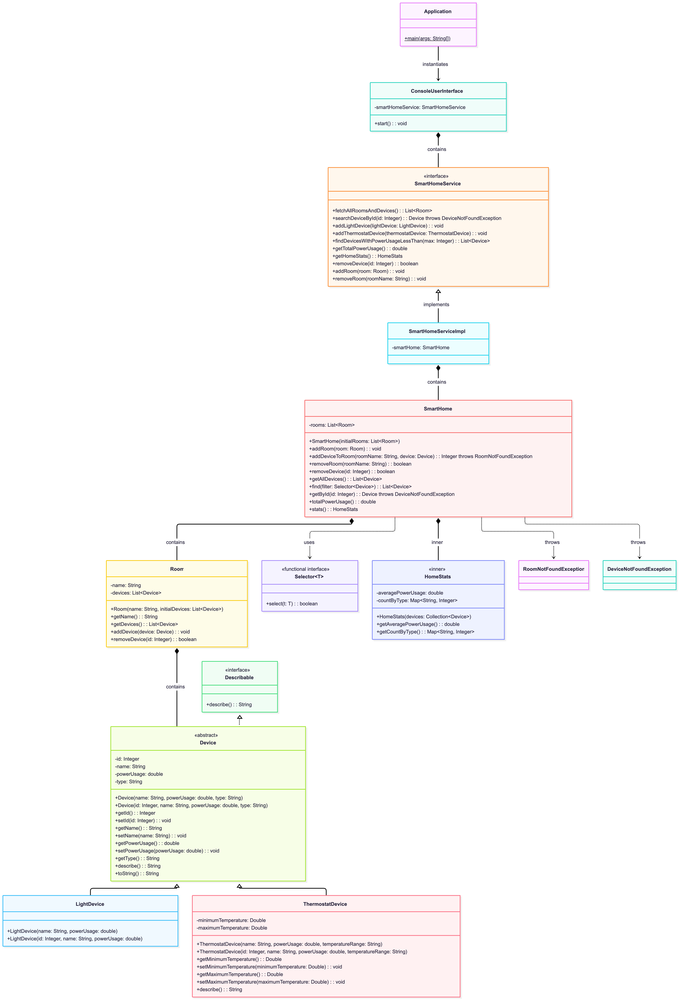
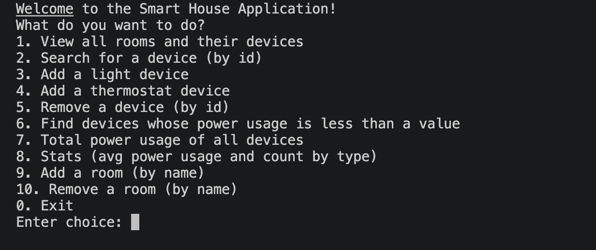

# Instructions
Consider this class diagram:

## Requirements
The application manages exactly one smart home for its entire lifetime. Once you exit the application, all the data is lost.

Your task is to implement the UML diagram and all the business logic so that the following features can be implemented with "console user interface", like the one in this image:

### Unit tests
Write unit tests for all the classes except for **ConsoleUserInterface** and **Application**, as they imply concepts not covered during the course.

### Details about the classes
- Input validation:
  - Reject empty strings and negative numbers when creating devices.
  - *temperatureRange* must not be empty for ThermostatDevice.
- About **Device** and related classes: 
  - *describe()* returns:  `| id: <id> || name: <name> || type: <type> |` plus type-specific fields (e.g., temperatureRange for ThermostatDevice).
  - *toString()* must return exactly the result of describe().
- About SmartHome:
  - *addDeviceToRoom(roomName, device): int* generates a new ID as max existing ID + 1 **across all rooms**. Assigns the ID to the device, ignoring any pre-set ID. Returns the generated ID.
  - *removeDevice(id: int): boolean* returns true if removed, false otherwise.
  - *getById(id: int): Device* throws DeviceNotFoundException if not found.
  - *getAllDevices(): List<Device>* returns a new list (never null).
  - *find(filter: Selector<Device>): List<Device>* returns a new list of matches (never null). Throws **NullPointerException** if filter is null.
  - *stats(): HomeStats* snapshot based on current devices only. No historical data.
- HomeStats:
  - *averagePowerUsage(): double* → arithmetic mean; returns 0.0 if empty.
  - *countByType(): Map<String,Integer>* → entry for each device type.
- Exceptions
  - *DeviceNotFoundException.getMessage()* must include the missing ID: `Device with id '<id>' not found.`

### General Rules
All collections returned must be non-null (empty if no results).

## Grading
| Topic                                      | Weight | 10                                                                                                           | 8                                                               | 6                                                                              | 4                                                                           | 2                                                               | 0                                                                      |
|--------------------------------------------|--------|--------------------------------------------------------------------------------------------------------------|-----------------------------------------------------------------|--------------------------------------------------------------------------------|-----------------------------------------------------------------------------|-----------------------------------------------------------------|------------------------------------------------------------------------|
| UML, Hierarchy and Interfaces              | 6      | UML fully understood; correct use of interfaces and inheritance; all classes and relationships match diagram | Minor inconsistencies with UML or interface/inheritance usage   | Fair understanding; most features supported despite structural differences     | Misunderstood entities or relationships; modifiers or types often incorrect | Significant structural issues; UML and code diverge notably     | No evidence of understanding UML, interfaces, or inheritance           |
| Polymorphism and Collections               | 6      | Polymorphism, collections, and generics used correctly and efficiently; code is clear and functional         | Minor issues in dynamic behavior or data abstraction            | Misunderstandings in polymorphism, collections, or generics; code mostly works | Incorrect application of behavior or data structures; readability suffers   | Mostly misunderstood; implementation incomplete or incorrect    | No evidence of polymorphism, collections, or generics where required   |
| Java Syntax, Coding Standards, and Testing | 6      | Classes in packages, code follows syntax perfectly, adheres to standards, and full unit tests  coverage      | Minor style/packages/test issues; overall readable and working  | Some package/style issues; tests present but with low coverage                 | Frequent deviation from coding standards; low test coverage; bad packages   | Major coding style issues; testing absent or fully incorrect    | Code does not compile; no testing at all                               |
| Exceptions                                 | 6      | Exception handling is correct and uses try-catch-finally appropriately                                       | Minor issues in structure or coverage                           | Misunderstandings in exception handling                                        | Incorrect application; readability suffers                                  | Mostly misunderstood; implementation incomplete or incorrect    | No evidence of exception handling where required                       |
| Inner Classes and Lambdas                  | 6      | Used correctly and improve code clarity; syntax is correct                                                   | Mostly correct usage with minor issues                          | Used but with misunderstandings                                                | Attempted but incorrectly applied                                           | Mostly misunderstood; implementation incomplete or incorrect    | No evidence of inner classes or lambdas where required                 |
| Spec driven                                | 4      | Evidence of effective AI usage is visible in the assignment (skills, agents, etc)                            | AI is used effectively but not for all the best practices       | Evidence of AI but with only some of the best practices                        | A few files for AI are present but very limited                             | Some sign of AI usage but only through ad-hoc prompting         | No evidence of AI at all                                               |
| Correctness                                | 2      | All features run without bugs.                                                                               | Some corner case scenarios run with some bugs                   | All the "happy flows" and most of the corner cases run successfully            | Some "happy flows" are implemented with bugs                                | Many bugs found in the application                              | All the features are implemented with bugs                             |
| Git                                        | 1      | Git history composed by many small commits with meaningful commit messages                                   | Many commits but not always with descriptive messages           | A handful of commits with meaningful messages                                  | A handful of commits with not so good messages                              | Only a few big commits                                          | Only 1 commit                                                          |
